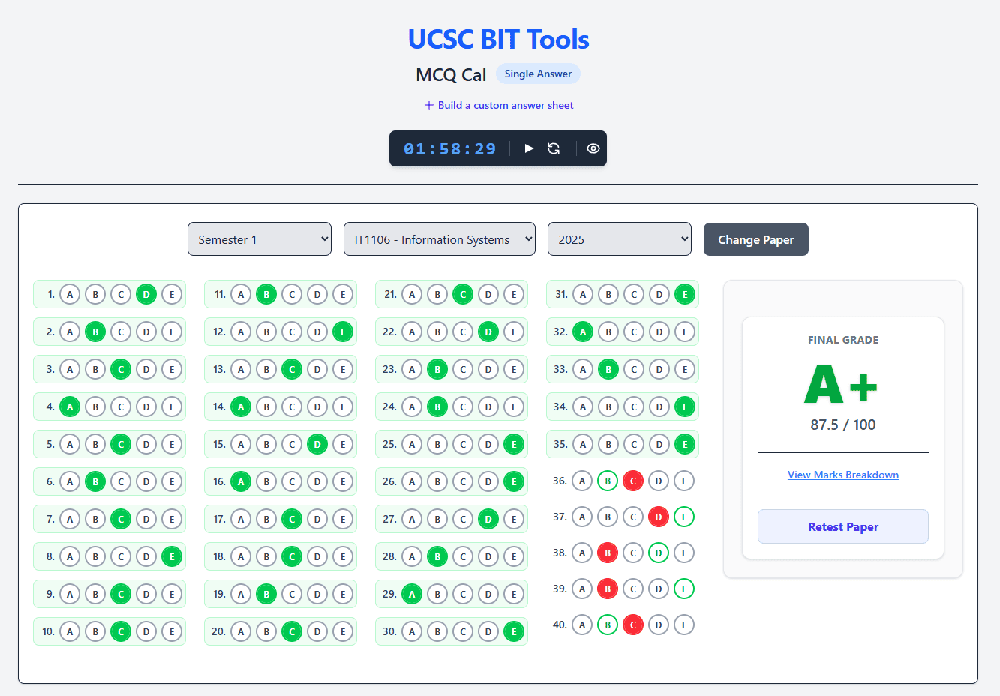

# UCSC BIT Exam Helper

A browser-based tool designed to help University of Colombo School of Computing (UCSC) BIT students practice past papers, calculate MCQ scores, and experiment with AI-assisted essay marking.



---

## 🚀 About The Project

Studying for UCSC BIT exams involves a lot of past paper practice. Manually calculating scores for multi-answer questions with negative marking is tedious, and essay answers also need to be considered against the syllabus and marking expectations.

**UCSC BIT Exam Helper** provides an interactive interface to:
-  Instantly grade your performance on official past papers.
-  Simulate exam conditions with a built-in timer.
-  Create and save your own custom answer sheets for mock exams or study sessions.
- View every essay question-paper page inline, place movable/resizable answer text and image overlays on the pages, and request marks from Gemini. Unanswered questions are allowed and receive zero; the paper is marked out of 50.

The MCQ calculator and custom papers run in your browser. Essay marking sends a flattened question-paper PDF with selectable typed-answer text and visible image overlays, catalog-linked lecturer answer PDFs, and subject notes to Google's Gemini API using the user's own API key. Do not submit sensitive information; Gemini's terms and data handling apply.

Essay practice appears when a selected year has a `part_2` paper and its subject is essay-enabled in `public/answer_sheets/papers.json`. Each year can contain an MCQ `part_1`, an essay `part_2`, or both. Subject notes and syllabi are linked in the subject's `notes` array. Use `public/` paths for repository files or HTTPS URLs for hosted material; only link materials you have permission to share. Downloaded materials are cached in the browser's Cache Storage and can be removed from Settings.

Add an `essay` property to each year that has essay questions. It can be a flat list of complete labels, which is the preferred format when only question numbers are needed:

```json
{
  "2024": {
    "essay": ["1 (a) (i)", "1 (a) (ii)", "2 (a)"]
  }
}
```

Nested question structures are also supported for existing data. A year may use an `essay` PDF path to load the question paper directly, or optionally include `paperPdf` (or `questionPaperPdf` / `questionPaper`). `lect_ans` (or `answerPdf` / `lectureAnswers`) identifies the lecturer reference PDFs. Notes and lecturer answers are loaded automatically from catalog metadata.

---

## ✨ Key Features

- **Accurate UCSC Marking:** Implements the exact grading formula for both Single Answer and Multi-Answer (with negative marking) papers.
- **Instant Grading & Analysis:** Get your final score, university-standard letter grade (A+, B-, E, etc.), and a detailed breakdown of your performance (Full Marks, Partial Marks, Wrong).
- **📝 Custom Paper Builder:** An advanced tool to create your own answer sheets! Define the question count, answer type, time limit, and even add official comments.
- **💾 Local Storage:** Your custom-built papers are saved directly in your browser, ready to use anytime.
- **📝 Essay Practice:** When a selected paper includes essays, read the centered, independently scrolling viewer (70% default zoom), add and resize text boxes or image overlays around the visible page area, and request structured marks from Gemini. The question-paper pages are flattened first, then typed answers are added as selectable PDF text and images as visual overlays. The submitted PDF is kept in memory for the current page session and reused for Gemini and downloads until an answer changes. The default 60-second Gemini request timeout, automatic retries (off by default; three additional attempts rotating Gemini 3.5 Flash, Gemini 3 Flash, and Gemini 2.5 Flash), automatic answer-sheet download, and MCQ paper viewer are configurable in Settings.
- **🤖 Gemini Model Controls:** Load the models available to the supplied API key, choose a model, and select a thinking level where the model supports it. The model and thinking preferences are stored in the browser; the API key remains separately encrypted or session-only.
- **🛠️ Developer Mode:** Essay settings can enable Gemini request details, detailed marking diagnostics, and a download of the stitched PDF sent to Gemini.
- **🌓 Light and Dark Themes:** Switch between light and dark appearance; the default is light.
- **🔐 User-provided Gemini key:** The key can be encrypted and saved in the current browser, or used for one session without saving.
- **⏱️ Live Exam Timer:** Practice under pressure with a fully functional timer (`HH:MM:SS`) that starts with your first MCQ answer or when you scroll the essay PDF. Includes pause, reset, and hide controls.
- **📱 Fully Responsive Design:** The interface adapts beautifully from large desktop monitors to mobile phones, with a unique vertical-column layout for easy scanning.
- **Interactive UI:**
    -  Clean, modern bubble-style inputs.
    -  Immediate visual feedback with solid Green/Red fills for your selected answers.
    -  Subtle hints (green borders) for correct answers you may have missed.
    -  Dynamic display of official paper comments and changes.

---

## 🤔 How This Helps a BIT Student

This tool is purpose-built to address the specific challenges faced by UCSC BIT undergraduates:

1.  **Master the Marking Scheme:** Stop guessing how negative marks are calculated. UCSC_BIT_MCQ_Cal shows you exactly how selecting one wrong answer can impact your score on a multi-answer question, helping you build better exam strategies.

2.  **Efficient Practice:** Grade an entire 40-question paper in a single click instead of spending 15 minutes manually checking and calculating. This frees up valuable study time.

3.  **Simulate Real Exam Conditions:** Use the timer to train your speed and accuracy. The clean, distraction-free interface helps you focus just like you would in an exam hall.

4.  **Consolidate Your Study Notes:** Have a set of tricky questions from different tutorials? Use the Custom Paper Builder to create a unique practice sheet for them and test yourself later.

---

## 💻 Tech Stack

-   **[Vite](https://vitejs.dev/):** A blazing-fast, next-generation frontend build tool.
-   **[Tailwind CSS](https://tailwindcss.com/):** A utility-first CSS framework for rapid, custom UI development.
-   **Vanilla JavaScript (ES Modules):** Modern, clean, and efficient JavaScript with no heavy frameworks.

---

## 🤝 How to Contribute

The most useful contributions are verified answer keys and accurate links to past-paper PDFs. Paper data lives under `public/answer_sheets/semN/`; the matching PDFs belong under `public/notes_papers/20-25sy/`. Use `public/answer_sheets/template.json` as the dual-paper example and replace its course and file paths.

A dual-exam year uses this structure:

```json
{
  "2025": {
    "time": "2H",
    "part_1": {
      "total_marks": 50,
      "comments": "",
      "answerType": "multi",
      "qcount": 25,
      "paper": "public/notes_papers/20-25sy/sem3/IT3406/PP/2025_P1.pdf",
      "questions": {
        "1": ["a", "c"],
        "2": ["b"]
      }
    },
    "part_2": {
      "total_marks": 100,
      "paper": "public/notes_papers/20-25sy/sem3/IT3406/PP/2025_P2.pdf",
      "lect_ans": "public/notes_papers/20-25sy/sem3/IT3406/PP/2025_P2_Ans.pdf"
    }
  }
}
```

Add all question numbers to `part_1.questions`. If an answer is not verified yet, use an empty array (for example `"3": []`) rather than guessing letters; the app will report that the key is incomplete and will not award a combined grade. Semester 1 and 2 papers are MCQ-only: use `part_1` with a 2-hour limit, except courses whose code starts with `EN`, which are 1-hour MCQ-only papers. Enrichment courses do not need notes or a `part_2`. Semester 6 non-enrichment papers can contain only `part_2`.

For essay-enabled subjects, set `"essay": true` in `public/answer_sheets/papers.json`. Add shared notes and the syllabus as `public/` paths in the subject's `notes` array; filenames containing `syllabus` are sent to Gemini before lecturer answers and study notes. Keep the labels and file paths accurate, and only share material you have permission to distribute.

1. Fork the project.
2. Update the relevant year JSON and add or link the PDF files.
3. Validate the JSON and check that every linked local file exists.
4. Open the home page (`index.html`) and exam tool (`exam.html`) locally to check both routes.
5. Open a pull request describing which papers or keys were verified.

Thank you for helping BIT students practice with reliable material.
